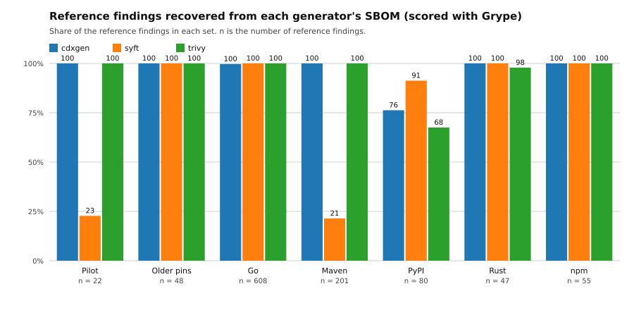
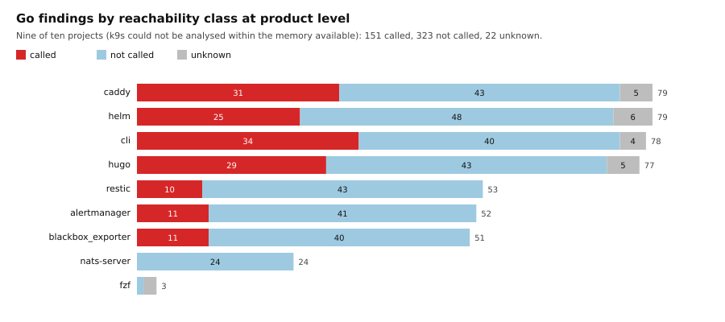
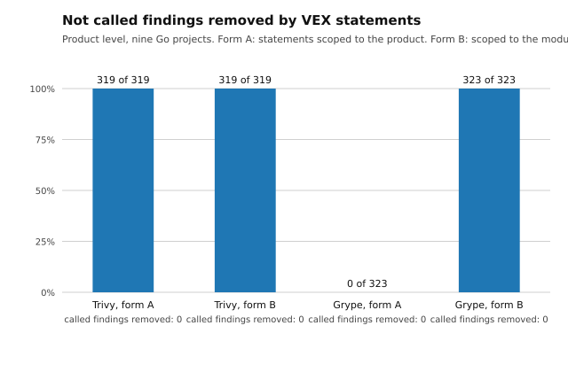

# Figures

Generated by harness/make_figures.py from summary files tracked in this repository. Regenerate with python3 harness/make_figures.py. python3 harness/check_all.py checks that these files match what the script produces.

## Figure 1

Share of the reference findings that each generator's SBOM recovers when scanned with Grype, per set. The reference is built from the shipped set of each project. For example Syft recovers 43 of 201 on Maven and cdxgen 61 of 80 on PyPI.

## Figure 2

Product level classes from govulncheck run on the packages of each shipped binary (results_go/reach_product.json): 215 called, 368 not called, 25 unknown over nine projects. k9s is missing because its analysis exceeded the memory available.

## Figure 3

Share of not called findings removed when the scanner is given VEX statements marking them not_affected (results_go/vex_set_product.csv). Called findings removed per combination: Trivy, form A 0, Trivy, form B 0, Grype, form A 0, Grype, form B 0.
